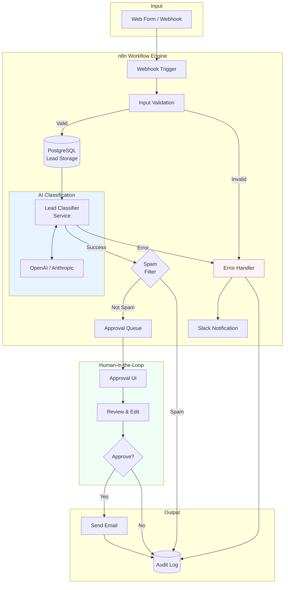

# AI Lead-to-CRM Workflow

> An n8n automation that uses AI to classify inbound leads, draft personalized responses, and route them for human approval before sending. Demonstrates production-ready AI automation patterns: structured LLM output, retries, logging, and human-in-the-loop approval.

**Author:** [Ashwin Sanjaye](https://ashwinsanjaye.com)  
**GitHub:** [github.com/asanjaye](https://github.com/asanjaye) · **Repo:** [ai-lead-to-crm](https://github.com/asanjaye/ai-lead-to-crm)  
**Tech Stack:** n8n, Python, PostgreSQL, Docker, OpenAI/Anthropic

---

## The Business Problem

Sales teams waste 15-25 hours per week manually triaging inbound leads:

- **Slow response times** — hot leads go cold waiting for qualification
- **Inconsistent classification** — different reps apply different standards  
- **Missed opportunities** — high-value leads buried under spam and tire-kickers
- **Compliance risk** — auto-sending emails without review can damage relationships

**The goal:** Automatically classify leads, draft personalized responses, and require human approval before anything sends — giving teams speed without losing control.

---

## Architecture



### Component Overview

| Component | Purpose | Technology |
|-----------|---------|------------|
| **Webhook Trigger** | Receives leads from forms, landing pages, or integrations | n8n Webhook node |
| **Lead Classifier** | AI-powered classification (hot/warm/cold/spam) + reply drafting | FastAPI + OpenAI/Anthropic |
| **PostgreSQL** | CRM-like storage with full audit trail | PostgreSQL 15 |
| **Approval UI** | Human review interface before sending | FastAPI + Jinja2 |
| **Error Handler** | Retries, logging, and failure notifications | n8n Error Workflow + Slack |

---

## How It Works

### 1. Lead Intake
A webhook receives the lead (name, email, company, message) and validates the input.

### 2. AI Classification
The lead is sent to the classifier service, which uses structured output prompting to return:
- **Classification:** hot, warm, cold, or spam
- **Intent:** What the lead is asking for (e.g., "pricing inquiry", "technical question")
- **Summary:** 1-2 sentence summary of their needs
- **Confidence Score:** 0.0-1.0 reliability metric

### 3. Reply Drafting
For non-spam leads, a personalized reply is generated matching the lead's tone and needs. The draft is:
- Personalized with their name, company, and specific questions
- Tone-matched to their classification (more enthusiastic for hot, more educational for cold)
- Ready for human review

### 4. Human Approval
Drafts are queued in the Approval UI where a human can:
- Review the AI's classification and reasoning
- Edit the draft subject/body if needed
- Approve (queues for sending) or reject (with notes)

**Nothing sends without explicit human approval.**

### 5. Error Handling
Built-in reliability patterns:
- **Retries:** 3 attempts with exponential backoff for transient failures
- **Error logging:** Full context saved for debugging
- **Notifications:** Slack alerts for failures requiring attention
- **Graceful degradation:** Leads are stored even if classification fails

---

## Setup & Installation

### Prerequisites
- Docker and Docker Compose
- An OpenAI or Anthropic API key

### Quick Start

```bash
# 1. Clone the repository
git clone <repo-url>
cd ai-lead-to-crm

# 2. Copy and configure environment
cp .env.example .env
# Edit .env and add your API key:
#   OPENAI_API_KEY=sk-your-key-here
#   or
#   LLM_PROVIDER=anthropic
#   ANTHROPIC_API_KEY=sk-ant-your-key-here

# 3. Start all services
docker-compose up -d

# 4. Import the workflow into n8n
# Open http://localhost:5678 in your browser
# Go to Workflows → Import from File
# Select workflows/ai-lead-to-crm.json
```

### Services Running

| Service | URL | Purpose |
|---------|-----|---------|
| n8n | http://localhost:5678 | Workflow engine |
| Lead Classifier | http://localhost:8001 | AI classification API |
| Approval UI | http://localhost:3001 | Human review interface |
| PostgreSQL | localhost:5432 | Database |

### Configure n8n Credentials

After importing the workflow:

1. Go to **Settings → Credentials**
2. Add a **Postgres** credential:
   - Host: `postgres`
   - Database: `leads_db`
   - User: `n8n`
   - Password: `n8n_password`
3. Activate the workflow

### Test the Webhook

```bash
curl -X POST http://localhost:5678/webhook/lead-intake \
  -H "Content-Type: application/json" \
  -d '{
    "name": "Sarah Chen",
    "email": "sarah@techstartup.io",
    "company": "TechStartup Inc",
    "message": "We need lead automation ASAP. Budget approved, can we talk today?"
  }'
```

Then visit http://localhost:3001 to see the lead in the approval queue.

---

## Evaluation Results

The classifier was evaluated against 25 labeled sample leads covering hot, warm, cold, and spam categories.

### Running the Eval

```bash
# Install eval dependencies
pip install -r eval/requirements.txt

# Run evaluation (requires classifier service running)
python eval/run_eval.py

# Or dry-run to see test data
python eval/run_eval.py --dry-run

# Save detailed results
python eval/run_eval.py --output results.json
```

### Measured Results (synthetic / dry-run)

These numbers are from local verification only — **not** live LLM accuracy benchmarks:

| Check | Result |
|-------|--------|
| **Unit tests** | 24/24 passed (`pytest tests/ -v`) |
| **Eval dry-run** | 25 labeled synthetic leads loaded successfully |
| **Dry-run class distribution** | hot: 7 · warm: 7 · cold: 7 · spam: 4 |

Live classifier accuracy requires an API key and a running classifier service (`python eval/run_eval.py`). No live accuracy figures are claimed in this repository.

---

## Extending to Production CRMs

This demo uses PostgreSQL as a self-contained CRM store. Here's how to integrate with real systems:

### Google Sheets
Replace the Postgres nodes with n8n's **Google Sheets** nodes:
1. Create a sheet with columns: Name, Email, Company, Message, Classification, Intent, Summary, Status
2. Use "Append Row" for new leads, "Update Row" for status changes
3. Configure OAuth credentials in n8n

### Airtable
Use n8n's **Airtable** nodes:
1. Create a base with a Leads table
2. Map fields to Airtable columns
3. Use "Create Record" and "Update Record" operations

### HubSpot
Use n8n's **HubSpot** nodes:
1. Create contacts with classification as a custom property
2. Use HubSpot workflows for follow-up sequences based on classification
3. Sync approval status back to HubSpot deal stage

### Salesforce
Use n8n's **Salesforce** nodes:
1. Create Leads with custom fields for AI classification
2. Map classification to Lead Rating or custom picklist
3. Trigger Salesforce automation rules based on classification

### Slack Notifications
The error handler already supports Slack. For success notifications:
1. Add a Slack node after the approval callback
2. Post to a #new-leads channel with classification and summary
3. Include buttons for quick approval from Slack (using interactive messages)

---

## Project Structure

```
├── docker-compose.yml          # All services orchestration
├── .env.example                # Environment template
├── workflows/
│   └── ai-lead-to-crm.json    # Importable n8n workflow
├── services/
│   ├── lead-classifier/       # AI classification microservice
│   │   ├── Dockerfile
│   │   ├── main.py           # FastAPI endpoints
│   │   └── classifier.py     # LLM integration
│   └── approval-ui/          # Human approval interface
│       ├── Dockerfile
│       ├── main.py
│       └── templates/        # Jinja2 HTML templates
├── data/
│   ├── schema.sql            # Database schema
│   └── sample_leads.json     # Test data with labels
├── eval/
│   └── run_eval.py           # Evaluation script
├── tests/
│   └── test_classifier.py    # Unit tests
├── README.md                  # This file
└── DEMO.md                    # Demo recording script
```

---

## Key Design Decisions

### Why a separate classifier service?
- **Testability:** Can run evals independent of n8n
- **Swappable:** Easy to change LLM providers
- **Scalable:** Can scale classifier separately from workflow engine

### Why PostgreSQL over SQLite?
- **Production-ready:** Same setup scales to real deployments
- **n8n compatibility:** n8n uses Postgres for its own storage
- **Audit capabilities:** Better for compliance logging

### Why human approval before sending?
- **Trust:** Clients don't want AI sending emails autonomously
- **Quality:** Humans catch edge cases AI misses
- **Compliance:** Required in many industries (legal, healthcare, finance)

---

## Running Tests

```bash
# Install test dependencies
pip install -r tests/requirements.txt

# Run all tests
pytest tests/ -v

# Run with coverage
pytest tests/ --cov=services/lead-classifier --cov-report=html
```

---

## License

MIT License - Free for personal and commercial use.

---

## About the Author

**Ashwin Sanjaye** builds AI automation systems — n8n workflows, LLM integrations, and business process automation.

- **Portfolio:** [ashwinsanjaye.com](https://ashwinsanjaye.com)
- **GitHub:** [github.com/asanjaye](https://github.com/asanjaye)
- **Email:** [sanjaye@usc.edu](mailto:sanjaye@usc.edu)
